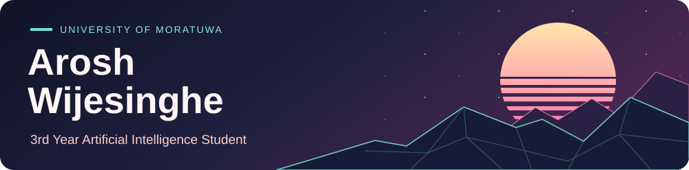

  Exploring the boundaries of AI / ML · Building intelligent systems for the future

<strong>Primary focus</strong> · AI / ML &emsp; <strong>Uptime</strong> · 24/7 &emsp; <strong>Location</strong> · Colombo, LK

## Current directives

**Currently learning**

AI/ML Engineering · Deep Learning & Computer Vision · Full-Stack Web Development · DevOps & Cloud Computing

**Interests**

Artificial Intelligence · Machine Learning & Deep Learning · Computer Vision (OpenCV) · Creative Problem Solving · UI/UX Design Thinking

## Tech arsenal

<strong>Languages</strong>

<table align="center">
  <tr align="center">
    <td width="96"> C</td>
    <td width="96"> C++</td>
    <td width="96"> Java</td>
    <td width="96"> Python</td>
    <td width="96"> JavaScript</td>
  </tr>
  <tr align="center">
    <td width="96"> PHP</td>
    <td width="96"> R</td>
    <td width="96"> Dart</td>
    <td width="96"> MySQL</td>
    <td width="96"></td>
  </tr>
</table>

<strong>AI &amp; ML</strong>

<table align="center">
  <tr align="center">
    <td width="96"> TensorFlow</td>
    <td width="96"> Scikit-Learn</td>
    <td width="96"> Pandas</td>
    <td width="96"> Numpy</td>
  </tr>
</table>

<strong>Frameworks &amp; technologies</strong>

<table align="center">
  <tr align="center">
    <td width="96"> React</td>
    <td width="96"> Next.js</td>
    <td width="96"> Node.js</td>
    <td width="96"> MongoDB</td>
    <td width="96"> Docker</td>
  </tr>
  <tr align="center">
    <td width="96"> HTML5</td>
    <td width="96"> CSS3</td>
    <td width="96"> FastAPI</td>
    <td width="96"> Arduino</td>
    <td width="96"></td>
  </tr>
</table>

<strong>Tools &amp; environment</strong>

<table align="center">
  <tr align="center">
    <td width="96"> Visual Studio</td>
    <td width="96"> VS Code</td>
    <td width="96"> PowerShell</td>
    <td width="96"> Ubuntu</td>
    <td width="96"> Postman</td>
  </tr>
  <tr align="center">
    <td width="96"> Git</td>
    <td width="96"> GitHub</td>
    <td width="96"> PyCharm</td>
    <td width="96"> Claude AI</td>
    <td width="96"> Cursor</td>
  </tr>
</table>

## GitHub activity

  
  

## Snake protocol

  <picture>
    <source media="(prefers-color-scheme: dark)" srcset="https://raw.githubusercontent.com/aroshwijesinghe/aroshwijesinghe/output/github-contribution-grid-snake-dark.svg">
    <source media="(prefers-color-scheme: light)" srcset="https://raw.githubusercontent.com/aroshwijesinghe/aroshwijesinghe/output/github-contribution-grid-snake.svg">
    
  </picture>

## Contact

[Email · aroshnimantha386@gmail.com](mailto:aroshnimantha386@gmail.com) &nbsp; / &nbsp; [LinkedIn · Arosh Wijesinghe](https://www.linkedin.com/in/arosh-wijesinghe-078423341/) &nbsp; / &nbsp; [Portfolio · arosh.dev](https://portfoilo-ruddy-two.vercel.app/)

  

